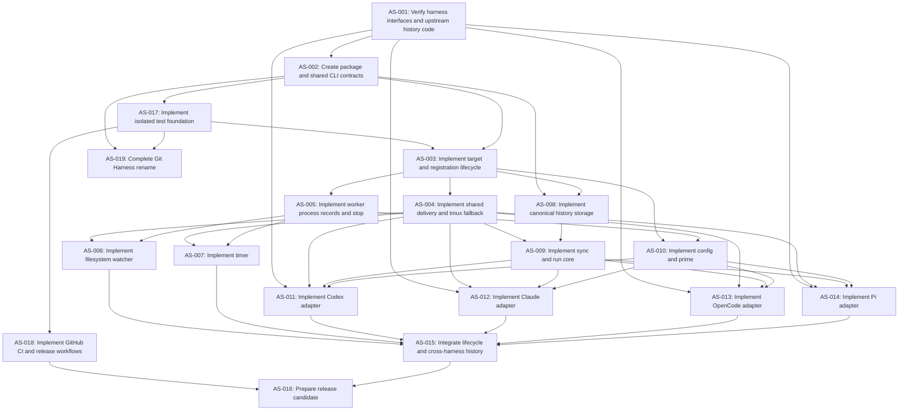

# Implementation graph

Task dependency metadata is authoritative. This graph is a derived planning view. Use parallel work only in isolated checkouts.

## Strategy

Verify native contracts first. Define both common interfaces and all ten command modules before parallel implementation. Keep each harness implementation and its resources in one package. Implement registration and worker ownership before triggers. Implement history storage and run core before native adapters. Integrate and verify all routes before release. The manager may split tasks further without changing requirements.

Implement AS-017 immediately after AS-002. Run AS-018 as soon as the test foundation is available; complete its native matrix as adapters become available. AS-016 requires AS-015 and AS-018. Do not publish during implementation.

Owner ordered AS-019 before resuming AS-003. Existing task IDs and dependency metadata are unchanged. AS-018 remains open for its full native gates.
